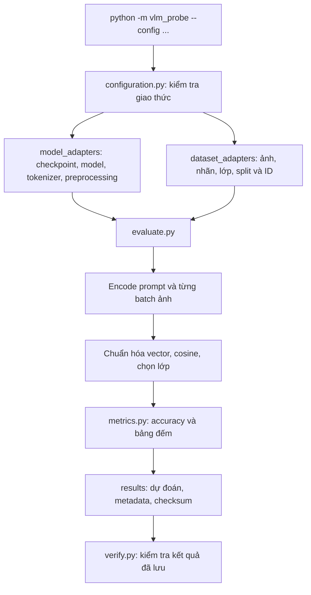

# Kiến trúc pipeline đánh giá

Pipeline hiện phục vụ **zero-shot classification bằng hai encoder ảnh/text và cosine similarity**. Các adapter giúp thêm model hoặc dataset mà không sao chép vòng lặp đánh giá. Giao diện này không mặc nhiên hỗ trợ VLM sinh câu trả lời tự do; dạng bài đó cần evaluator và giao thức riêng.

Phạm vi hiện hành là [một model × năm dataset](one_model_protocol.md). Registry nạp OpenAI CLIP ViT-B/32 và CIFAR-100, Flowers102, Oxford-IIIT Pet, DTD partition 1, Food-101. Ba dataset mới dùng protocol v3; Pet/DTD/Food kiểm tra archive gốc và từng ảnh test sau giải nén. Các model LAION/SigLIP của kế hoạch cũ không nằm trong phạm vi hiện hành.

`vlm_probe/probing/` tái sử dụng model adapter, có bộ tạo cảnh (`stimuli.py`), evaluator cho các lựa chọn caption (`evaluate.py`), metrics/CI (`metrics.py`) và bộ kiểm chứng độc lập với suy luận (`audit.py`). Lệnh `python -m vlm_probe.probing` chạy counting/spatial/negation và fine-grained; giao thức nằm trong [probing_protocol.md](probing_protocol.md). `vlm_probe/report.py` đọc kết quả đã kiểm chứng để tạo CSV, biểu đồ và Markdown dưới `reports/`.

## Trách nhiệm từng phần

| Thành phần | Trách nhiệm | Khi nào cần sửa/thêm |
| --- | --- | --- |
| `configuration.py` | Kiểm tra schema, phiên bản giao thức, tham số CLI và đường dẫn | Khi bổ sung loại thí nghiệm hoặc chính sách prompt |
| `model_adapters/__init__.py` | Giao diện `ModelAdapter`, chọn implementation và kiểm tra cấu hình model | Đăng ký adapter model mới |
| `model_adapters/openai_clip.py` | Tải và xác minh checkpoint, tạo CLIP/QuickGELU, tokenizer và preprocessing | Chỉ các chi tiết thuộc checkpoint OpenAI |
| `dataset_adapters/__init__.py` | `DatasetBundle`, chọn loader và giao thức dataset | Đăng ký dataset mới |
| `dataset_adapters/cifar100.py` | Đọc CIFAR-100, kiểm tra checksum, fine labels và split | Chỉ các quy tắc của CIFAR-100 |
| `dataset_adapters/flowers102.py` | Đọc Flowers102, kiểm tra split/nhãn và ảnh đã giải nén với archive gốc | Chỉ các quy tắc của Flowers102 |
| `evaluate.py` | Thiết lập tính toán, tạo batch, encode, cosine, ghi dự đoán và provenance | Khi thay cách đánh giá chung |
| `metrics.py` | Top-1 accuracy, accuracy từng lớp, confusion matrix | Khi thêm định nghĩa metric |
| `verify.py` | Kiểm tra artifact, nhãn đầu vào, kích thước, metrics và giao thức | Khi đổi định dạng đầu ra hoặc thêm giao thức kiểm tra |
| `compare.py` | So sánh từng dự đoán của hai lần chạy cùng cấu hình | Kiểm chứng refactor, yêu cầu môi trường và dữ liệu giống nhau |

`ModelAdapter` cung cấp `preprocess`, `embedding_dim`, `metadata`, `encode_images(images)` và `encode_texts(texts)`. Tokenization nằm trong adapter. Evaluator chuẩn hóa L2 các vector rồi kiểm tra số hàng, chiều vector, giá trị hữu hạn và độ dài vector.

`DatasetBundle` cung cấp `images` (dataset trả về ảnh đã preprocess và nhãn), `targets`, `classes`, `sample_ids` và `metadata`. Thứ tự các danh sách phải khớp; nhãn là ID nguyên từ 0 đến số lớp − 1. Dataset adapter kiểm tra quy tắc riêng của nguồn dữ liệu, ví dụ CIFAR-100 test bắt buộc 100 ảnh/lớp. Evaluator không giả định mọi dataset cân bằng hoặc có 100 lớp.

## Thêm model, dataset và ảnh văn hóa Việt Nam

1. **Model mới:** thêm một file trong `model_adapters/`, triển khai cùng giao diện, ghi checkpoint/checksum/tokenizer/preprocessing vào metadata và đăng ký loader/validator. Thêm config và giao thức thích hợp. Không thay checkpoint trong config v1 rồi gọi đó là baseline cũ.
2. **Dataset mới:** thêm file trong `dataset_adapters/`, cung cấp `DatasetBundle`, khai báo split, số lớp, số ảnh, nguồn tải và các điều kiện toàn vẹn. Đăng ký trong registry và tạo config. Không sửa vòng lặp cosine để xử lý số lớp mới.
3. **Ảnh văn hóa Việt Nam:** có thể thêm `dataset_adapters/vietnamese_culture.py` đọc danh mục ảnh do nhóm biên soạn. Ảnh nằm dưới `data/` (Git bỏ qua), còn danh mục có ID, nhãn, đường dẫn tương đối, nguồn, quyền sử dụng và split nên được version hóa. Cần chốt nhãn, tách tập phát triển/test và kiểm tra ảnh trùng trước khi chạy.
4. **Prompt tiếng Việt hoặc ensemble:** thêm giao thức/config và logic tạo prompt/embedding tương ứng. Hiện config cố định một prompt tiếng Anh để giữ baseline; chưa có hỗ trợ tiếng Việt hoặc ensemble chỉ bằng đổi chuỗi trong config.
5. **Counting, spatial, negation:** tái sử dụng model adapter, nhưng cần thiết kế mẫu ảnh–caption đúng/sai và evaluator/metric phù hợp. Không ép mọi bài probing thành phân loại lớp thông thường.

## Đầu ra và khả năng tái lập

Mỗi lần chạy mới có `artifact_schema_version: 2` trong manifest. Ngoài các tệp baseline cũ, `samples.json` lưu thứ tự, ID ảnh và nhãn đầu vào. `predictions.csv` phải khớp danh sách này. Tên cột `test_index` được giữ để tương thích; đây là vị trí trong split, không nhất thiết là số trong tên file ảnh.

Manifest ghi hash **đệ quy** toàn bộ file Python trong package, config, requirements, checkpoint, các tệp nguồn dữ liệu và artifact. Nó cũng ghi số mẫu đầy đủ của split, số mẫu đã đánh giá, support từng lớp và kích thước embedding. Verifier hoạt động không cần tải model/GPU; nó kiểm tra tính toàn vẹn và nhất quán của kết quả đã lưu, không tự chạy suy luận lại. Hash không phải chữ ký chống việc sửa đồng thời toàn bộ kết quả và manifest.

`protocol_version` mô tả thí nghiệm; `artifact_schema_version` mô tả định dạng lưu. Vì thế baseline CIFAR-100 giữ protocol v1 dù được chạy bằng code mới và tạo artifact schema v2. Verifier tiếp tục đọc artifact cũ không có trường schema.

Mã nguồn baseline ban đầu được giữ ở `results/source_snapshots/baseline_v1.zip`, đã đối chiếu từng hash với manifest cũ trước khi refactor. Không ghi đè thư mục kết quả cũ. Các bản code chưa commit được nhận diện bằng hash; snapshot giúp giữ lại nội dung để tái lập, không chỉ hash.

Code sau bước refactor CIFAR-100 được giữ ở `results/source_snapshots/refactor_cifar100.zip`; snapshot này khớp source hash của lần chạy đối chiếu. Code có thêm Flowers102 được giữ ở `results/source_snapshots/multi_dataset_v2.zip` để phân biệt hai mốc triển khai.
