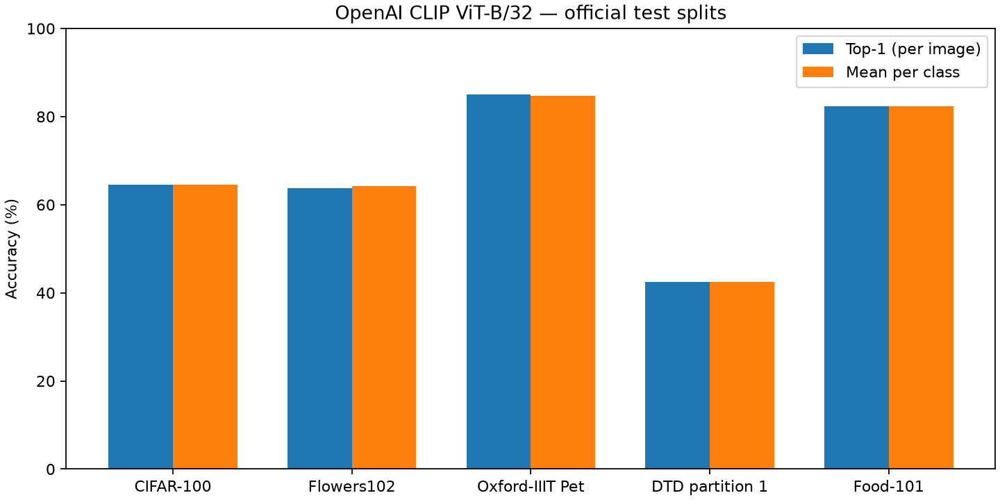

# Baseline một model trên năm dataset

**Đã kiểm chứng tất cả 5 full test run.** Cùng OpenAI CLIP ViT-B/32, FP32, QuickGELU, không training/fine-tuning. CIFAR-100 và Flowers102 dùng kết quả đã lưu; ba dataset còn lại là các ô mới.

| Dataset | Lớp | Ảnh test | Đúng | Top-1 | Trung bình theo lớp |
| --- | ---: | ---: | ---: | ---: | ---: |
| CIFAR-100 | 100 | 10000 | 6448 | 64.4800% | 64.4800% |
| Flowers102 | 102 | 6149 | 3921 | 63.7665% | 64.2338% |
| Oxford-IIIT Pet | 37 | 3669 | 3121 | 85.0641% | 84.7193% |
| DTD partition 1 | 47 | 1880 | 798 | 42.4468% | 42.4468% |
| Food-101 | 101 | 25250 | 20784 | 82.3129% | 82.3129% |



Top-1 là tỷ lệ đúng trên toàn bộ ảnh. Trung bình theo lớp cho mỗi lớp trọng số bằng nhau; hai metric có thể khác trên Flowers/Pet vì số ảnh mỗi lớp không đều. Không gộp năm dataset thành một accuracy chung vì Food-101 sẽ chi phối kết quả.

Prompt cố định `a photo of a {class}.`, riêng DTD là `a photo of a {class} texture.`. DTD chỉ dùng test partition 1, không phải trung bình 10 partition. Các con số giữa dataset phản ánh cả miền ảnh, số lớp và prompt, không phải so sánh model.

Dữ liệu chi tiết: [toàn bộ 387 lớp](per_class.csv), [mọi cặp nhầm có quan sát](confusion_pairs.csv), [bảng tổng hợp](summary.csv), [biên bản đầu vào](inputs.json).

## CIFAR-100

[Kết quả gốc](../../results/full_cifar100_clip_b32_v1/metrics.json) · [Dự đoán từng ảnh](../../results/full_cifar100_clip_b32_v1/predictions.csv) · [Confusion matrix đầy đủ](../../results/full_cifar100_clip_b32_v1/confusion_matrix.csv)

Năm lớp có accuracy thấp nhất (xếp theo accuracy, rồi tên lớp):

| Lớp | Đúng / số ảnh | Accuracy |
| --- | ---: | ---: |
| ray | 5 / 100 | 5.00% |
| otter | 12 / 100 | 12.00% |
| lobster | 17 / 100 | 17.00% |
| porcupine | 19 / 100 | 19.00% |
| mouse | 23 / 100 | 23.00% |

Năm cặp nhầm có nhiều ảnh nhất; chiều mũi tên là nhãn thật → dự đoán:

| Cặp nhầm | Số ảnh | % trong lớp thật |
| --- | ---: | ---: |
| ray → flatfish | 34 | 34.00% |
| oak_tree → pine_tree | 30 | 30.00% |
| trout → flatfish | 30 | 30.00% |
| woman → girl | 29 | 29.00% |
| cloud → plain | 27 | 27.00% |

## Flowers102

[Kết quả gốc](../../results/full_flowers102_clip_b32_v2/metrics.json) · [Dự đoán từng ảnh](../../results/full_flowers102_clip_b32_v2/predictions.csv) · [Confusion matrix đầy đủ](../../results/full_flowers102_clip_b32_v2/confusion_matrix.csv)

Năm lớp có accuracy thấp nhất (xếp theo accuracy, rồi tên lớp):

| Lớp | Đúng / số ảnh | Accuracy |
| --- | ---: | ---: |
| ball moss | 0 / 26 | 0.00% |
| bishop of llandaff | 0 / 89 | 0.00% |
| bolero deep blue | 0 / 20 | 0.00% |
| cape flower | 0 / 88 | 0.00% |
| great masterwort | 0 / 36 | 0.00% |

Năm cặp nhầm có nhiều ảnh nhất; chiều mũi tên là nhãn thật → dự đoán:

| Cặp nhầm | Số ảnh | % trong lớp thật |
| --- | ---: | ---: |
| petunia → mexican petunia | 146 | 61.34% |
| geranium → pelargonium | 82 | 87.23% |
| cape flower → gaura | 66 | 75.00% |
| watercress → californian poppy | 53 | 32.32% |
| marigold → english marigold | 47 | 100.00% |

## Oxford-IIIT Pet

[Kết quả gốc](../../results/full_oxford_pet_clip_b32_v3/metrics.json) · [Dự đoán từng ảnh](../../results/full_oxford_pet_clip_b32_v3/predictions.csv) · [Confusion matrix đầy đủ](../../results/full_oxford_pet_clip_b32_v3/confusion_matrix.csv)

Năm lớp có accuracy thấp nhất (xếp theo accuracy, rồi tên lớp):

| Lớp | Đúng / số ảnh | Accuracy |
| --- | ---: | ---: |
| Bombay | 0 / 88 | 0.00% |
| Ragdoll | 30 / 100 | 30.00% |
| Persian | 49 / 100 | 49.00% |
| Boxer | 58 / 99 | 58.59% |
| Staffordshire Bull Terrier | 55 / 89 | 61.80% |

Năm cặp nhầm có nhiều ảnh nhất; chiều mũi tên là nhãn thật → dự đoán:

| Cặp nhầm | Số ảnh | % trong lớp thật |
| --- | ---: | ---: |
| Ragdoll → Birman | 67 | 67.00% |
| Bombay → Russian Blue | 52 | 59.09% |
| Boxer → American Bulldog | 32 | 32.32% |
| Persian → Birman | 30 | 30.00% |
| Staffordshire Bull Terrier → American Pit Bull Terrier | 20 | 22.47% |

## DTD partition 1

[Kết quả gốc](../../results/full_dtd_clip_b32_v3/metrics.json) · [Dự đoán từng ảnh](../../results/full_dtd_clip_b32_v3/predictions.csv) · [Confusion matrix đầy đủ](../../results/full_dtd_clip_b32_v3/confusion_matrix.csv)

Năm lớp có accuracy thấp nhất (xếp theo accuracy, rồi tên lớp):

| Lớp | Đúng / số ảnh | Accuracy |
| --- | ---: | ---: |
| lacelike | 0 / 40 | 0.00% |
| flecked | 1 / 40 | 2.50% |
| pitted | 1 / 40 | 2.50% |
| zigzagged | 1 / 40 | 2.50% |
| banded | 2 / 40 | 5.00% |

Năm cặp nhầm có nhiều ảnh nhất; chiều mũi tên là nhãn thật → dự đoán:

| Cặp nhầm | Số ảnh | % trong lớp thật |
| --- | ---: | ---: |
| dotted → polka-dotted | 36 | 90.00% |
| banded → striped | 35 | 87.50% |
| lacelike → paisley | 25 | 62.50% |
| lined → striped | 25 | 62.50% |
| swirly → paisley | 22 | 55.00% |

## Food-101

[Kết quả gốc](../../results/full_food101_clip_b32_v3/metrics.json) · [Dự đoán từng ảnh](../../results/full_food101_clip_b32_v3/predictions.csv) · [Confusion matrix đầy đủ](../../results/full_food101_clip_b32_v3/confusion_matrix.csv)

Năm lớp có accuracy thấp nhất (xếp theo accuracy, rồi tên lớp):

| Lớp | Đúng / số ảnh | Accuracy |
| --- | ---: | ---: |
| steak | 106 / 250 | 42.40% |
| foie_gras | 124 / 250 | 49.60% |
| ravioli | 124 / 250 | 49.60% |
| apple_pie | 142 / 250 | 56.80% |
| lasagna | 144 / 250 | 57.60% |

Năm cặp nhầm có nhiều ảnh nhất; chiều mũi tên là nhãn thật → dự đoán:

| Cặp nhầm | Số ảnh | % trong lớp thật |
| --- | ---: | ---: |
| onion_rings → fried_calamari | 70 | 28.00% |
| steak → filet_mignon | 68 | 27.20% |
| apple_pie → bread_pudding | 50 | 20.00% |
| breakfast_burrito → huevos_rancheros | 44 | 17.60% |
| steak → prime_rib | 38 | 15.20% |

## Câu hỏi đưa sang probing

- Khi giữ nguyên màu và hình, đổi số lượng 1–6 có làm model chọn đúng số không? So sánh kích thước vật thể cố định với tổng diện tích cố định.
- Khi giữ nguyên hai vật thể và chỉ đổi vị trí, model phân biệt trái/phải/trên/dưới được không?
- Khi chỉ thay việc có/không có vật thể được hỏi, model đổi lựa chọn giữa câu khẳng định và phủ định được không?
- Trong cùng một nhóm lớn CIFAR-100, model còn nhầm bao nhiêu khi chỉ chọn giữa năm lớp gần nhau?

Các cặp nhầm baseline gợi ý nơi cần xem sâu, chưa xác định nguyên nhân nhân quả. Ba câu hỏi đếm/vị trí/phủ định cần bộ ảnh kiểm soát riêng; accuracy classification không trực tiếp đo chúng.

## Tái lập báo cáo

```powershell
conda activate gen
python -m vlm_probe.report baseline
```

Lệnh kiểm tra artifact và tính lại bảng/biểu đồ; không chạy model. Giao thức và lệnh chạy inference: [README](../../README.md), [phạm vi hiện hành](../../docs/one_model_protocol.md).
