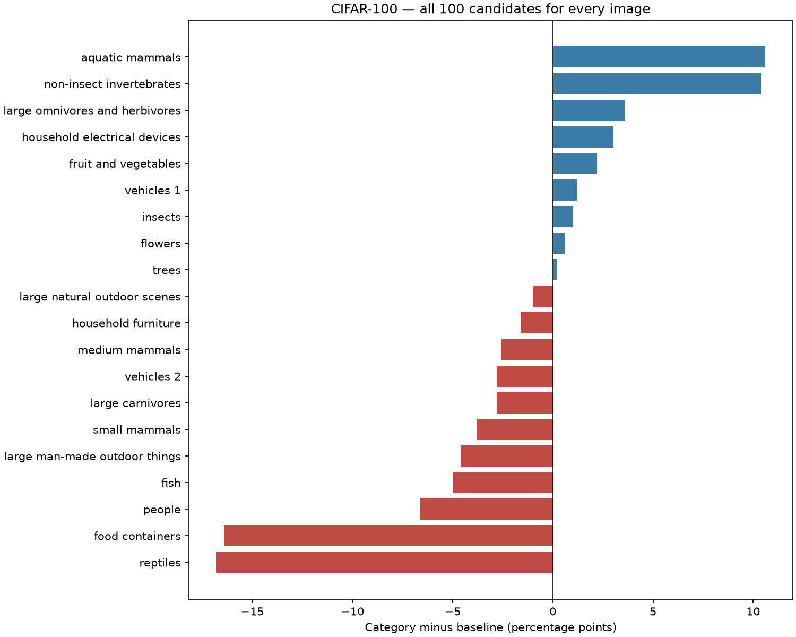

# CIFAR-100: thêm category vào prompt

Một checkpoint OpenAI CLIP ViT-B/32, cùng 10.000 ảnh test và cùng vector ảnh cho hai điều kiện. Mỗi ảnh luôn chọn giữa đủ 100 lớp. Ánh xạ nhóm cha lấy từ nhãn fine/coarse của **train**, không dùng nhãn nhóm thật của ảnh test để thu hẹp ứng viên.

| Điều kiện | Prompt | Đúng / ảnh test | Top-1 | Mean per-class |
| --- | --- | ---: | ---: | ---: |
| baseline | `a photo of a {class}.` | 6448 / 10000 | 64.48% | 64.48% |
| category | `a photo of a {class}, a type of {category}.` | 6292 / 10000 | 62.92% | 62.92% |

**Chênh lệch category − baseline: -1.56 điểm phần trăm.** CI 95% bootstrap ghép cặp, phân tầng theo fine class: [-2.15; -0.96] điểm phần trăm (1.000 lần, seed 0).

| Chuyển trạng thái | Số ảnh |
| --- | ---: |
| Sai → đúng | 416 |
| Đúng → sai | 572 |
| Cả hai đúng | 5876 |
| Cả hai sai | 3136 |

Tổng ảnh đổi nhãn dự đoán: 1890; bao gồm cả trường hợp đổi từ một nhãn sai sang nhãn sai khác.

## Thay đổi theo lớp

Trong 100 lớp: **45 lớp tăng, 50 lớp giảm, 5 lớp không đổi accuracy**. Các lớp tăng/giảm nhiều nhất dưới đây được chọn sau khi tổng hợp để minh họa; kết quả đầy đủ của cả 100 lớp được giữ trong CSV.

### Tăng nhiều nhất

| Lớp | Nhóm | Baseline | Category | Chênh lệch (điểm %) |
| --- | --- | ---: | ---: | ---: |
| cloud | large_natural_outdoor_scenes | 57.00% | 83.00% | +26.00 |
| worm | non-insect_invertebrates | 59.00% | 81.00% | +22.00 |
| beaver | aquatic_mammals | 31.00% | 50.00% | +19.00 |
| lobster | non-insect_invertebrates | 17.00% | 32.00% | +15.00 |
| seal | aquatic_mammals | 39.00% | 53.00% | +14.00 |
| snail | non-insect_invertebrates | 56.00% | 70.00% | +14.00 |
| caterpillar | insects | 31.00% | 44.00% | +13.00 |
| baby | people | 74.00% | 85.00% | +11.00 |
| whale | aquatic_mammals | 60.00% | 71.00% | +11.00 |
| beetle | insects | 57.00% | 67.00% | +10.00 |

### Giảm nhiều nhất

| Lớp | Nhóm | Baseline | Category | Chênh lệch (điểm %) |
| --- | --- | ---: | ---: | ---: |
| cup | food_containers | 59.00% | 26.00% | -33.00 |
| plate | food_containers | 76.00% | 43.00% | -33.00 |
| snake | reptiles | 65.00% | 32.00% | -33.00 |
| girl | people | 73.00% | 45.00% | -28.00 |
| plain | large_natural_outdoor_scenes | 73.00% | 50.00% | -23.00 |
| shrew | small_mammals | 43.00% | 20.00% | -23.00 |
| dinosaur | reptiles | 67.00% | 49.00% | -18.00 |
| cockroach | insects | 63.00% | 48.00% | -15.00 |
| shark | fish | 47.00% | 33.00% | -14.00 |
| flatfish | fish | 56.00% | 43.00% | -13.00 |

## Lỗi trong và ngoài nhóm lớn

| Điều kiện | Sai nhưng cùng coarse group | Sai sang coarse group khác |
| --- | ---: | ---: |
| baseline | 1335 | 2217 |
| category | 1387 | 2321 |

Các nhóm dùng để phân tích sau dự đoán; không lọc ứng viên khi suy luận.



## Kiểm chứng và giới hạn

Baseline chạy lại khớp đủ 10.000 dự đoán với baseline core. Cosine của lớp đúng/lớp được chọn và margin có sai khác tuyệt đối tối đa 0 (ngưỡng 1e-6). Audit tính lại dự đoán từ cả hai ma trận cosine 10.000 × 100 và tính lại metrics/CI.

Phép thử đo tác động của **một cách thêm category cố định**. Chưa tách hoàn toàn tác động của thông tin ngữ nghĩa khỏi độ dài/cấu trúc câu; chưa phải nghiên cứu tám template hoặc ensembling. Không dùng kết quả để chọn lại cách viết category. Hai nhóm vehicles cùng dùng từ vehicle. Kết quả không so trực tiếp với fine-grained oracle 5-way.

[Toàn bộ 100 lớp và prompt](../../results/full_cifar100_category_v1/classes.json) · [Accuracy từng lớp](../../results/full_cifar100_category_v1/per_class.csv) · [20 nhóm](../../results/full_cifar100_category_v1/per_category.csv) · [Dự đoán từng ảnh](../../results/full_cifar100_category_v1/predictions.csv) · [Cosine scores](../../results/full_cifar100_category_v1/scores.npz) · [Giao thức](../../docs/cifar100_category_protocol.md) · [Audit](audit.json)

```powershell
python -m vlm_probe.category_study.audit results/full_cifar100_category_v1
python -m vlm_probe.category_study.report results/full_cifar100_category_v1
```
