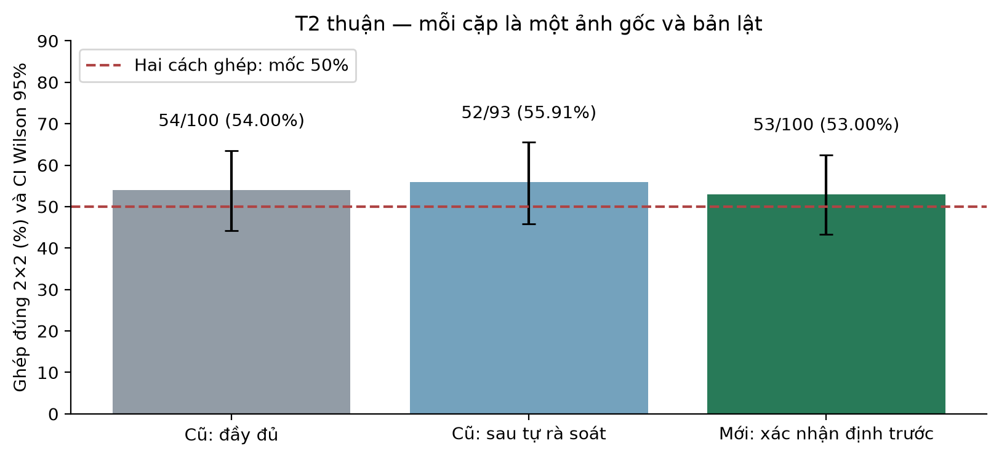

# Rà soát nhãn và xác nhận trên tập ảnh mới

[Báo cáo PDF cập nhật](bao_cao_cap_nhat.pdf) · [LaTeX](bao_cao_cap_nhat.tex) · [Số liệu đầy đủ](metrics.json) · [Nguồn và checksum](sources.json)

Đã hoàn thành: tự rà soát 200 ảnh cũ → chốt giao thức → rà soát/chọn ảnh mới chưa chạy CLIP → kiểm chứng → cập nhật báo cáo. Một checkpoint CLIP ViT-B/32, môi trường conda gen, RTX 4050 Laptop, FP32/batch 32. Không đổi prompt theo kết quả mới, không fine-tuning. [Giao thức](../../docs/natural_confirmation_protocol.md), [config](../../configs/natural_confirmation_v1.json).

## 1. Rà soát 200 ảnh cũ

Trợ lý xem lại đủ 13 trang ảnh, không hiển thị dự đoán từng ảnh hoặc lý do chấp nhận trước đây. Kết quả tổng hợp cũ đã biết, nên đây là **tự rà soát bổ sung**, không phải annotator độc lập hoặc mù hoàn toàn.

- Giữ 176/200 ảnh; 24 ảnh có vấn đề về che khuất, cắt xén, tên lớp, hoặc đối tượng được in trên bao bì thay vì vật thể thật.
- Mọi quyết định, ID và lý do nằm trong [old_review_decisions.csv](old_review_decisions.csv).
- Không sửa danh sách gốc, scores hay run cũ. Dùng scores đã lưu để tính một phân tích độ nhạy riêng.

| Chỉ số T2 thuận | Toàn bộ tập cũ | Sau tự rà soát |
|---|---:|---:|
| Ảnh gốc của bài bốn quan hệ | 200 | 176 |
| Accuracy bốn lựa chọn | 28,00% | 28,41% |
| Số nguồn có quan hệ ngang dùng ghép 2×2 | 100 | 93 |
| Accuracy ghép 2×2 | 54,00% | 55,91% (52/93) |

Loại ảnh có vấn đề không làm thay đổi lớn các điểm ước lượng. Đây là mô tả độ nhạy, không chứng minh hai tập/phương pháp tương đương. Bộ 176 ảnh không còn cân bằng hoàn toàn bốn nhãn, nên không so các accuracy như một thử nghiệm cải tiến có phân phối giữ nguyên.

## 2. Tập xác nhận mới

Loại cả 400 source ID đã từng được xem, gồm cả ảnh không được chọn trong thí nghiệm cũ. Metadata COCO val2014 còn 178 ảnh đạt cùng bộ lọc và có quan hệ ngang. Rà soát tất cả 178 ảnh qua 12 trang ảnh, giữ 112; chọn 100 ảnh đầu theo rank SHA256 seed 14031. Cả original và mirror dHash được so với 400 ảnh cũ; không có cặp nào dưới ngưỡng ≤6. Rà soát trực quan vẫn phát hiện và loại một cảnh gần trùng cũ (COCO 502318 so với COCO 355214), cho thấy dHash không bảo đảm loại hết gần trùng.

Danh sách 100 ảnh đã được đóng băng lúc **2026-11-04 16:17:49 UTC**, trước khi run bắt đầu **16:19:04 UTC**. Không ảnh mới nào được chạy CLIP trước khi chọn xong. Smoke/kiểm tra phép tính dùng scores ảnh cũ; không mở một phần holdout để sửa pipeline.

Mỗi nguồn tạo một ảnh gốc và một bản lật, tổng 200 ảnh đầu vào, ba template × hai thứ tự = 1.200 lượt chấm bốn caption. Metric chính dùng ma trận hai ảnh × hai câu trái/phải:

`D = S00 + S11 − S01 − S10`; D dương là ghép đúng tốt hơn ghép chéo.

Thành phần cộng riêng theo ảnh/caption triệt tiêu; đây không phải phép loại mọi thiên lệch. Mốc hai cách ghép là 50%. Cố định T2 thuận trước suy luận; các điều kiện khác là phụ. Tập mới chỉ có nhãn ngang nên không đối chiếu accuracy 4-way của nó với 28% trên bốn quan hệ cân bằng cũ.

## 3. Kết quả xác nhận

| Chỉ số chính T2 thuận | Kết quả |
|---|---:|
| Ghép đúng | **53/100 = 53,00%** |
| CI Wilson 95% | **[43,29%; 62,49%]** |
| CI bootstrap theo ảnh nguồn | [43,00%; 63,00%] |
| Kiểm định nhị thức một phía so với 50% | **p = 0,3086** |
| Phân loại trái/phải riêng từng ảnh | 103/200 = 51,50% |
| Cả ảnh gốc và bản lật đều chọn đúng | **4/100 = 4,00%** |
| Exact tie / near-tie trong metric chính | 0 / 0 |

Kiểm định chính không bác bỏ H0 ở alpha 0,05: **chưa có bằng chứng rõ rằng xác suất ghép đúng cao hơn 50% trong tập này**. Không kết luận model hoàn toàn không chứa thông tin vị trí, p đúng bằng 50%, hoặc có hiệu năng tương đương đoán ngẫu nhiên.



| Điều kiện mới | Ghép đúng (%) | Cả hai ảnh đúng (%) |
|---|---:|---:|
| T0 thuận | 52,00 | 3,00 |
| T0 đảo tương đương | 54,00 | 4,00 |
| T1 thuận | 55,00 | 2,00 |
| T1 đảo tương đương | 54,00 | 1,00 |
| **T2 thuận — chính** | **53,00** | **4,00** |
| T2 đảo tương đương | 50,00 | 3,00 |

Công bố đủ sáu điều kiện; không chọn T1 55% làm kết quả chính. So với 54% của tập cũ đầy đủ, chênh lệch mới−cũ là −1 điểm %, CI bootstrap hai tập độc lập [−15; +12]. Khoảng này rộng; không đủ kết luận tập mới kém hơn hoặc tương đương tập cũ. Không gộp tập thăm dò cũ vào kết quả xác nhận chính.

Hai con số 53% và 4% đo hai việc khác nhau: 53% là chọn giữa **hai cách ghép toàn bộ cặp**; 4% yêu cầu model **tự chọn đúng cho từng ảnh trong cả hai ảnh**. Một caption vẫn có thể thắng trên cả hai ảnh, trong khi chênh lệch tổng điểm của hai cách ghép mang dấu đúng. Phải giữ cách diễn giải này khi trình bày.

## 4. Kết luận nghiên cứu và giới hạn

Phát hiện mới tiếp nối quan sát cũ: khả năng đổi đáp án theo quan hệ trái/phải còn thiếu ổn định; cách loại thiên lệch cộng riêng không đem lại tín hiệu ghép đúng rõ ràng trên tập xác nhận. Những ảnh cũ khó xác nhận không giải thích được toàn bộ kết quả thấp, vì phân tích trên 176 ảnh còn lại vẫn gần điểm ước lượng trước đó.

Tuy nhiên, cùng một trợ lý AI rà soát cả hai tập, chưa có người đánh giá độc lập hoặc inter-annotator agreement. Giả thuyết được hình thành từ tập cũ; chỉ giao thức/tập mới được cố định trước suy luận. Tập mới độc lập về ID so với các ảnh từng được xem, nhưng cùng miền COCO; không bảo đảm độc lập với pretraining hoặc loại hết gần trùng. Nhãn coarse như `tv`, `cup`, `dining table` có thể có ranh giới khác cách gọi thông thường; tự rà soát mang tính chủ quan. Không biến việc loại mẫu thành tuyên bố annotation COCO chắc chắn sai. 100 nguồn ảnh cho CI còn rộng, các metric phụ chưa hiệu chỉnh đa so sánh. Không có đối chứng nhận dạng vật thể riêng trên ảnh tự nhiên.

Năm baseline, kết quả can thiệp không gian và category vẫn giữ nguyên trong [báo cáo mốc trước](../probing_depth_v1/README.md). Báo cáo PDF mới tóm tắt các kết quả đó và đưa phần xác nhận vào cùng lập luận.

## 5. Code, kiểm chứng và tái lập

- `vlm_probe/depth/confirmation.py`: chuẩn bị dữ liệu, sàng lọc gần trùng, đóng băng review, tính ghép cặp/Wilson/binomial, inference và audit.
- `vlm_probe/depth/confirmation_report.py`: phân tích độ nhạy cũ, CI chênh lệch hai tập độc lập, bảng/biểu đồ và số liệu LaTeX.
- `vlm_probe/depth/natural.py`: thêm tùy chọn lọc quan hệ; mặc định v1 vẫn xét đủ bốn quan hệ.
- `tests/test_confirmation.py`: sáu kiểm thử về CI, tie, ghép cặp, triệt tiêu thành phần cộng, parity scores cũ và tách source ID.
- **43 tests đạt**. Audit kiểm checksum, snapshot, config, nhãn/box gốc, disjoint IDs, timestamp freeze; tính lại scores→metrics/predictions/pairs.

Từ repo, trong conda `gen`:

```powershell
python -m vlm_probe.depth.confirmation audit
python -m vlm_probe.depth.confirmation report
python -m unittest discover -s tests -v
```

Để khôi phục ảnh/sheet đã chọn, không thay review:

```powershell
python -m vlm_probe.depth.confirmation prepare-old
python -m vlm_probe.depth.confirmation prepare-new
```

Ảnh cũ có thể khôi phục trước bằng `python -m vlm_probe.depth natural-prepare`. Mọi ảnh/checkpoint nằm trong data/models/cache bị Git bỏ qua. Run mới vào thư mục khác, không ghi đè:

```powershell
python -m vlm_probe.depth.confirmation run --run-name natural_confirmation_repeat
python -m vlm_probe.depth.confirmation audit --run-name natural_confirmation_repeat
```

Report luôn đọc full run v1 đã định danh. Tệp LaTeX đọc bảng/số liệu sinh từ JSON. Biên dịch bằng Tectonic/XeLaTeX:

```powershell
tectonic --outdir reports/natural_confirmation_v1 reports/natural_confirmation_v1/bao_cao_cap_nhat.tex
```

Bước tiếp theo hợp lý là dùng báo cáo này để giảng viên review thiết kế và mức độ kết luận. Nếu cần bằng chứng mạnh hơn, thêm người rà soát nhãn hoặc một tập nguồn khác được chốt trước; chưa cần fine-tuning. Không tự động kéo dài thí nghiệm cho đến khi đạt p-value mong muốn.
