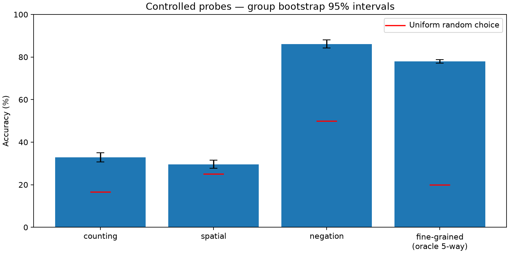
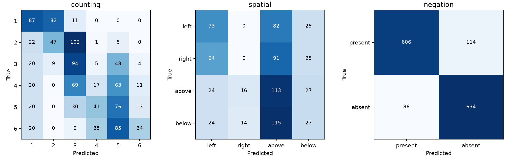
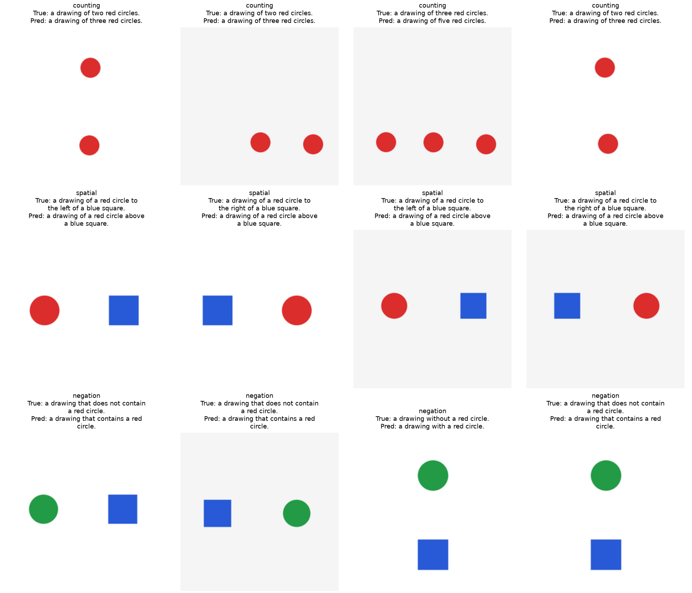

# Core probing — OpenAI CLIP ViT-B/32

Bốn bài kiểm tra đã chạy đầy đủ theo [giao thức định trước](../../docs/probing_protocol.md). Ba bài đầu dùng hình học tự tạo; fine-grained dùng ảnh CIFAR-100 tự nhiên.

| Bài kiểm tra | Số mẫu | Đúng | Accuracy | CI 95% | Ngẫu nhiên |
| --- | ---: | ---: | ---: | ---: | ---: |
| counting | 1080 | 355 | 32.87% | 30.65–35.00% | 16.67% |
| spatial | 720 | 213 | 29.58% | 27.77–31.53% | 25.00% |
| negation | 1440 | 1240 | 86.11% | 84.23–88.06% | 50.00% |
| fine_grained | 10000 | 7795 | 77.95% | 77.16–78.77% | 20.00% |



CI được bootstrap 1.000 lần, seed 0, lấy lại mẫu theo nhóm cảnh để giữ quan hệ giữa các ảnh đối chứng/caption của cùng cảnh. Fine-grained lấy lại mẫu theo ảnh. Đây là mức biến thiên trong bộ kiểm tra này, không bao quát mọi ảnh hay mọi VLM.

## Kiểm tra nhận dạng đối chứng

| Bài | Nhận dạng đối chứng đúng | Probe đúng trong số đối chứng đúng |
| --- | ---: | ---: |
| counting | 804 / 1080 = 74.44% | 277 / 804 = 34.45% |
| spatial | 702 / 720 = 97.50% | 208 / 702 = 29.63% |
| negation | 1406 / 1440 = 97.64% | 1222 / 1406 = 86.91% |

Counting dùng nhận dạng 9 tổ hợp màu/hình; spatial và negation dùng phân biệt hai mô tả vật thể không có từ quan hệ/phủ định. Kết quả đối chứng giúp kiểm tra khả năng nhận dạng cơ bản nhưng không loại hết ảnh hưởng của cách diễn đạt hoặc miền hình học.

## counting

Margin đúng trừ đối thủ tốt nhất trung bình: -0.003227. Near-tie (≤1e-6): 0; exact tie: 0.

| Điều kiện | Đúng / số mẫu | Accuracy |
| --- | ---: | ---: |
| fixed_radius | 175 / 540 | 32.41% |
| fixed_total_area | 180 / 540 | 33.33% |

Sai số số lượng tuyệt đối trung bình: **1.0157 vật thể**.

## spatial

Margin đúng trừ đối thủ tốt nhất trung bình: -0.003108. Near-tie (≤1e-6): 0; exact tie: 0.

| Điều kiện | Đúng / số mẫu | Accuracy |
| --- | ---: | ---: |
| above | 113 / 180 | 62.78% |
| below | 27 / 180 | 15.00% |
| to the left of | 73 / 180 | 40.56% |
| to the right of | 0 / 180 | 0.00% |

Nhóm đúng cả bốn vị trí: **0.00%**.

## negation

Margin đúng trừ đối thủ tốt nhất trung bình: 0.009436. Near-tie (≤1e-6): 0; exact tie: 0.

| Điều kiện | Đúng / số mẫu | Accuracy |
| --- | ---: | ---: |
| contains_does_not | 582 / 720 | 80.83% |
| with_without | 658 / 720 | 91.39% |

Tỷ lệ chọn câu khẳng định: **48.06%**. Nhóm đúng cả present/absent và hai template: **58.61%**.

- absent: 634/720 = 88.06%.
- present: 606/720 = 84.17%.

## fine_grained

Margin đúng trừ đối thủ tốt nhất trung bình: 0.018540. Near-tie (≤1e-6): 0; exact tie: 0.

| Điều kiện | Đúng / số mẫu | Accuracy |
| --- | ---: | ---: |
| aquatic_mammals | 320 / 500 | 64.00% |
| fish | 283 / 500 | 56.60% |
| flowers | 386 / 500 | 77.20% |
| food_containers | 394 / 500 | 78.80% |
| fruit_and_vegetables | 435 / 500 | 87.00% |
| household_electrical_devices | 449 / 500 | 89.80% |
| household_furniture | 398 / 500 | 79.60% |
| insects | 406 / 500 | 81.20% |
| large_carnivores | 363 / 500 | 72.60% |
| large_man-made_outdoor_things | 456 / 500 | 91.20% |
| large_natural_outdoor_scenes | 412 / 500 | 82.40% |
| large_omnivores_and_herbivores | 449 / 500 | 89.80% |
| medium_mammals | 371 / 500 | 74.20% |
| non-insect_invertebrates | 372 / 500 | 74.40% |
| people | 361 / 500 | 72.20% |
| reptiles | 363 / 500 | 72.60% |
| small_mammals | 336 / 500 | 67.20% |
| trees | 331 / 500 | 66.20% |
| vehicles_1 | 461 / 500 | 92.20% |
| vehicles_2 | 449 / 500 | 89.80% |

Dùng **nhãn nhóm lớn thật (oracle)** để giới hạn còn 5 lớp ứng viên. Đây là chẩn đoán lỗi trong nhóm, không phải cải thiện zero-shot 100 lớp. Cả 10.000 dự đoán khi vẫn chọn trên toàn bộ 100 lớp khớp baseline cũ từng ảnh.

## Phân bố nhầm lẫn



Hàng là nhãn thật, cột là dự đoán; các ô ghi số mẫu. Với negation, present ứng với câu khẳng định, absent ứng với câu phủ định.

## Ví dụ lỗi



Chọn bốn lỗi đầu tiên của mỗi bài có đối chứng nhận dạng đúng, theo thứ tự mẫu cố định. Đây là minh họa hậu nghiệm, không phải tập đánh giá mới hoặc ước lượng tỷ lệ lỗi. [ID và caption từng ví dụ](error_examples.csv).

## Phạm vi diễn giải

Negation có 1.440 mẫu ảnh–caption nhưng chỉ 720 ảnh duy nhất vì mỗi ảnh dùng hai template. Counting có 1.080 ảnh; spatial có 720 ảnh. Không gộp accuracy các bài có số lựa chọn khác nhau. Kết quả một checkpoint không cho phép so sánh điểm yếu giữa nhiều model. Bộ kiểm tra tự xây không phải bản chạy lại CountBench, ARO hay NegBench.

[Chi tiết từng điều kiện](breakdown.csv) · [Tóm tắt CSV](summary.csv) · [Mọi cosine score](../../results/full_probing_clip_b32_v1/predictions.jsonl) · [Metrics và confusion matrices](../../results/full_probing_clip_b32_v1/metrics.json) · [Kiểm chứng](inputs.json)

```powershell
python -m vlm_probe.probing.audit results/full_probing_clip_b32_v1
python -m vlm_probe.report probing --run-name full_probing_clip_b32_v1
```
