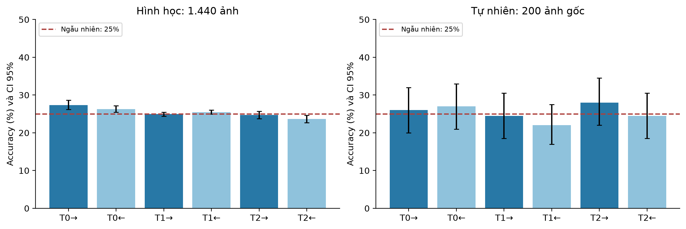
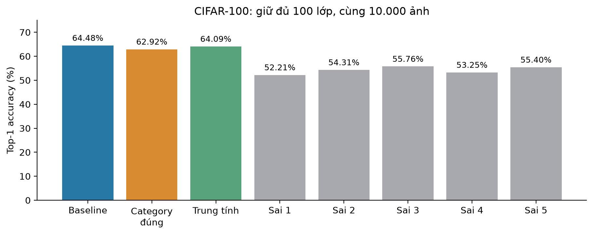
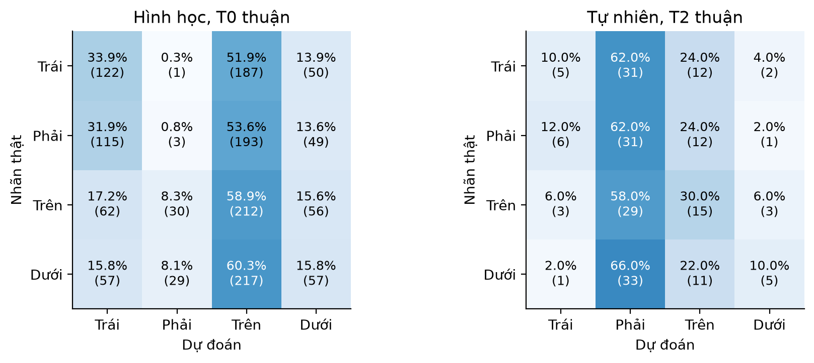

# Báo cáo probing chuyên sâu — một checkpoint CLIP ViT-B/32

[PDF tiếng Việt](bao_cao_probing_chuyen_sau.pdf) · [Nguồn LaTeX](bao_cao_probing_chuyen_sau.tex) · [Nguồn số liệu và checksum](sources.json)

Phần bổ sung hoàn thành theo thứ tự: giao thức → phân tích dữ liệu cũ → can thiệp không gian → đối chứng category → kiểm chứng ảnh tự nhiên → báo cáo. Năm baseline và core trước đây được giữ nguyên. Không huấn luyện hoặc thay checkpoint. Kết quả dưới đây là thực đo, không phải dự kiến.

## 1. Thiết kế và dữ liệu

- [Giao thức](../../docs/probing_depth_protocol.md), [config](../../configs/probing_depth_v1.json): giả thuyết được hình thành sau khi quan sát kết quả core; điều kiện/metric bổ sung chốt trước suy luận tương ứng.
- Hình học: 120 nhóm cảnh × 3 biến thể màu/hình × 4 vị trí = **1.440 ảnh**. Ba template × hai thứ tự tương đương = **8.640 phép thử**. Đối chứng nhận dạng dùng cùng ảnh.
- Category: **10.000 ảnh CIFAR-100 × 8 điều kiện**, cùng vector ảnh; luôn xét đủ 100 lớp. Năm ánh xạ sai cố định trước, giữ phân bố cụm category và không giữ lại category đúng.
- Tự nhiên: **200 ảnh COCO val2014** cân bằng 50 ảnh mỗi quan hệ, thêm 200 bản lật ngang, tổng **2.400 phép thử**. Lọc/rá soát 400 ứng viên trước suy luận, 258 đạt tiêu chí, chọn 200 theo thứ tự cố định. Xem [quy trình rà soát](../../docs/natural_depth_review.md).
- Bootstrap 2.000 lần, seed 1402: nhóm cảnh cho hình học; ảnh nguồn cho tự nhiên; ghép cặp phân tầng lớp cho CIFAR-100. Không coi nhiều caption/ảnh lật là các mẫu độc lập. CI chưa hiệu chỉnh đa so sánh; bảng theo lớp và phân tích phụ mang tính mô tả.
- Các lần chạy giữ config/protocol, checkpoint, preprocessing, môi trường, scores, dự đoán, checksum và ZIP nguồn mã. Config tự nhiên đổi từ val2017 sang val2014 **trước suy luận** vì val2017 chỉ có 70 ảnh đạt bộ lọc; không nới ngưỡng hình học. Các snapshot trước sửa đổi vẫn được giữ nguyên.

## 2. Phân tích dữ liệu cũ

[Thư mục kết quả](../../results/full_depth_historical_v1) có thống kê đủ 100 lớp category và breakdown theo điều kiện/màu/hình của probing.

- Không gian cũ: mô hình chọn “trên” 401/720 lần (**55,69%**) trên dữ liệu cân bằng; không có nhóm nào đúng cả bốn vị trí.
- Đếm: kích thước vật thể cố định đạt **32,41%**, tổng diện tích cố định đạt **33,33%**. Sai số số lượng có dấu trung bình **−0,195**; không có nhóm nào đúng cả sáu số lượng. Hai tỷ lệ gần nhau không chứng minh cơ chế đếm đã được cô lập.
- Phủ định: `with/without` đạt **91,39%**, `contains/does not contain` đạt **80,83%**. Chỉ **58,61%** nhóm đúng cả hai trạng thái và hai cách viết. Không kết luận tuyệt đối “CLIP không hiểu phủ định”.
- Category: điểm lớp đúng trung bình tăng **0,001628**, nhưng điểm đối thủ mạnh nhất tăng **0,002908**; margin giảm **0,001280**. Đối thủ mạnh nhất có thể đổi tên lớp: khi giữ cố định đối thủ baseline, thay đổi điểm trung bình là **−0,000111**. Vì vậy không diễn giải rằng cùng một lớp sai luôn được nâng điểm.

## 3. RQ1 — Không gian có phản ứng nhất quán không?

Template: T0 `a drawing/photo of {A} {relation} {B}.`; T1 `{A} is {relation} {B}.`; T2 `an image of {A} {relation} {B}.`. “Đảo” đổi thứ tự A/B và đảo quan hệ để giữ nguyên nghĩa. Trước tính metric, mọi dự đoán được quy về hệ quan hệ A–B.

| Điều kiện | Hình học, 1.440 ảnh (%) | Tự nhiên, 200 ảnh gốc (%) |
|---|---:|---:|
| T0 thuận | 27,36 | 26,00 |
| T0 đảo tương đương | 26,25 | 27,00 |
| T1 thuận | 24,93 | 24,50 |
| T1 đảo tương đương | 25,49 | 22,00 |
| T2 thuận | 24,72 | 28,00 |
| T2 đảo tương đương | 23,68 | 24,50 |



Metric chính hình học T0 thuận: **27,36%**, CI 95% **[26,18; 28,61]**, đối chứng nhận dạng **96,94%**; trên phần nhận dạng đúng, quan hệ đạt **27,51%**. Mức ngẫu nhiên của bài bốn lựa chọn là 25%.

- Cặp trái/phải cùng đúng: **2/360 = 0,56%**; cặp trên/dưới cùng đúng: **6/360 = 1,67%**. Không nhóm nào đúng cả bốn vị trí.
- Dự đoán cùng quan hệ giữa hai cách viết tương đương T0: **16,25%**; cả hai cùng đúng: **2,99%**.
- Khi thay màu/hình nhưng giữ vị trí: chỉ **17,92%** bộ ba có cùng dự đoán; **4,79%** bộ ba đều đúng, với T0 thuận.
- Mô hình chọn “trên” **809/1.440 = 56,18%**. Thay đổi vị trí không đủ làm đáp án đổi đúng một cách ổn định.
- Dự đoán trên ảnh thật của phép thử và nền trống chỉ trùng **23,82%**: không có căn cứ quy toàn bộ lỗi cho một đáp án ưu tiên trên nền trống.

**Diễn giải:** nhận dạng màu/hình tốt không bảo đảm kết hợp đúng vật thể với quan hệ. Kết quả thay đổi theo cách viết và thuộc tính không quyết định quan hệ; đây là bằng chứng hành vi trong bộ kiểm tra, chưa xác định được lỗi nằm ở tầng nào của encoder.

## 4. RQ2 — Category tác động như thế nào?

| Điều kiện | Top-1 (%) | Chênh so baseline (điểm %) |
|---|---:|---:|
| Baseline | 64,48 | 0,00 |
| Category đúng | 62,92 | −1,56 |
| Nội dung trung tính | 64,09 | −0,39 |
| Category sai, seed 271 | 52,21 | −12,27 |
| Category sai, seed 272 | 54,31 | −10,17 |
| Category sai, seed 273 | 55,76 | −8,72 |
| Category sai, seed 274 | 53,25 | −11,23 |
| Category sai, seed 275 | 55,40 | −9,08 |



| So sánh chốt trước | Chênh (điểm %) | CI 95% ghép cặp |
|---|---:|---:|
| Đúng − baseline | −1,56 | [−2,14; −0,98] |
| Đúng − trung tính | −1,17 | [−1,77; −0,61] |
| Đúng − trung bình 5 ánh xạ sai | +8,734 | [+8,140; +9,330] |

Baseline và category đúng khớp toàn bộ **10.000 nhãn dự đoán** đã lưu trước đây; audit kiểm sai khác cosine tối đa ≤1e−6. Category đúng sửa 416 lỗi nhưng tạo 572 lỗi mới; 45 lớp tăng, 50 giảm, 5 không đổi. Lỗi trong nhóm tăng **1.335→1.387**, lỗi khác nhóm tăng **2.217→2.321**. Không thể quy toàn bộ suy giảm cho sự khó phân biệt giữa các lớp cùng nhóm.

Suffix trung tính khớp số token ở 80 lớp, lệch −1 ở 10 lớp và +1 ở 10 lớp; chỉ chọn theo tokenizer. CI của trung tính−baseline là [−0,92; +0,11] điểm %, không đủ khẳng định hai phương pháp tương đương. Đối chứng độ dài/cú pháp còn chưa hoàn hảo.

**Diễn giải:** sự phù hợp của category có ảnh hưởng rõ so với category sai; tuy nhiên việc bổ sung category đúng theo cách viết này vẫn làm giảm accuracy so với tên lớp đơn thuần. Điểm lớp đúng tăng chưa đủ nếu cạnh tranh giữa các lớp thay đổi bất lợi. Năm ánh xạ sai là năm điều kiện cố định, không phải năm mô hình độc lập; CI không bao phủ mọi ánh xạ có thể có.

## 5. RQ3 — Hiện tượng có lặp lại trên ảnh tự nhiên?

Metric chính đã chốt T2 thuận: **56/200 = 28,00%**, CI 95% **[22,00; 34,50]**, bao gồm mức ngẫu nhiên 25%. Đây không phải bằng chứng mô hình tương đương một bộ đoán ngẫu nhiên; dữ liệu chưa cho thấy khoảng cách rõ với mốc đó.

- Chọn “phải” **124/200 = 62,00%** trên ảnh gốc; hình học lại nghiêng về “trên”. **Thiên lệch tồn tại, nhưng hướng thiên lệch không giữ nguyên giữa hai miền.**
- Hai cách viết tương đương T2 cùng dự đoán: **15,00%** trên 400 ảnh đầu vào; cùng đúng: **5,50%**.
- Gốc và lật cùng đúng: **21/200 = 10,50%** (CI [6,50; 15,00]). Riêng 100 cặp có nhãn trái/phải thật sự phải đổi khi lật: chỉ **3/100 = 3,00%** cùng đúng. Không dùng các cặp trên/dưới, vốn giữ nguyên nhãn khi lật, để phóng đại khả năng đổi đáp án.
- Ảnh gốc đạt 28%, ảnh lật 30%; không coi 400 ảnh là 400 nguồn độc lập. Không có đối chứng nhận dạng vật thể riêng trên COCO, nên không khẳng định mọi lỗi tự nhiên đều thuần túy do quan hệ.



Tập này được lọc từ [COCO](https://arxiv.org/abs/1405.0312), không đại diện toàn bộ COCO hay mọi ảnh tự nhiên. Rà soát trực quan do **một trợ lý AI**, kết hợp validator hình học; chưa có hai annotator người độc lập hoặc độ đồng thuận nhãn. Các quyết định nhận/loại lưu trước suy luận, có thể rà soát lại. Ảnh không đưa vào Git; URL và giấy phép từng ảnh được giữ.

## 6. Phân tích bổ sung sau khi xem kết quả: ghép cặp 2×2

[Định nghĩa và trạng thái thăm dò](../../docs/depth_exploratory_pair_analysis.md). Với hai ảnh đổi vị trí và hai caption tương ứng, tính `D = S11 + S22 − S12 − S21`. Dương nghĩa ghép đúng tốt hơn ghép chéo. Phép trừ triệt tiêu thành phần điểm cộng riêng theo ảnh hoặc caption; không loại mọi loại thiên lệch. Đây là bài hai cách ghép, được biết trước trục quan hệ, mốc ngẫu nhiên **50%**, không so trực tiếp với accuracy bốn lựa chọn.

- Hình học T0 thuận: ghép đúng **45,00%** cặp ngang; **42,50%** cặp dọc.
- Tự nhiên T2 thuận, 100 cặp ngang: **54,00%**, CI **[45,00; 64,00]**.

Sau loại thành phần cộng riêng, chưa thấy bằng chứng mạnh về tín hiệu ghép ảnh–quan hệ đúng trong các điều kiện này. Điều này thu hẹp cách giải thích “chỉ do một caption luôn có điểm cao”, nhưng không chứng minh mô hình hoàn toàn không chứa thông tin vị trí. Phép phân tích được thêm sau khi xem kết quả nên không gọi là kiểm chứng độc lập; công bố đủ 12 điều kiện hình học và 6 tự nhiên trong `exploratory_pair_metrics.json`.

## 7. Mã nguồn, kiểm chứng và chạy lại

| Tệp/module | Chức năng |
|---|---|
| `vlm_probe/depth/common.py` | Inference FP32, cache có provenance, CI, manifest/source snapshot |
| `design.py` | Cảnh phản thực, caption tương đương, category sai và trung tính |
| `analysis.py` | Phân tích scores và lỗi cũ, đủ 100 lớp |
| `spatial.py` | Evaluator quan hệ, consistency, margin, đối chứng nhận dạng/nền |
| `category.py` | Tám điều kiện, parity với baseline, phân tích cạnh tranh |
| `natural.py` | Tải annotation/ảnh, lọc/rá soát, cố định mẫu, validator và lật ảnh |
| `pairs.py` | Phân tích ghép cặp 2×2 hậu nghiệm |
| `audit.py` | Kiểm hash/nguồn mã/thiết kế, tính lại metrics và dự đoán từ scores |
| `report.py` | Dựng CSV, PNG/PDF vector và số liệu LaTeX từ run đã audit |
| `tests/test_depth.py` | Kiểm nhãn/bố cục, biến đổi tương đương, bootstrap, đối chứng và audit |

Từ thư mục repo trong `conda activate gen`:

Kiểm chứng hiện tại: **37 tests đạt**; bảy run chính/smoke đều vượt audit tính lại dự đoán và metrics. Một lần chạy lại phân tích lịch sử vào thư mục mới cũng khớp toàn bộ năm tệp số liệu của run gốc.

```powershell
python -m vlm_probe.depth audit
python -m vlm_probe.depth report
python -m unittest discover -s tests -v
```

Audit ảnh cần dữ liệu cục bộ. Khôi phục ảnh tự nhiên/sheet bằng `python -m vlm_probe.depth natural-prepare`; giữ nguyên manifest review đã cung cấp. Để chạy lại inference vào **thư mục mới**, không ghi đè kết quả đã đóng băng:

```powershell
python -m vlm_probe.depth spatial --smoke --run-name depth_spatial_smoke_repeat
python -m vlm_probe.depth spatial --run-name depth_spatial_repeat
python -m vlm_probe.depth category --run-name depth_category_repeat
python -m vlm_probe.depth natural --run-name depth_natural_repeat
python -m vlm_probe.depth audit --run results/depth_natural_repeat
```

Model/dataset được tái sử dụng qua adapter hiện hành; CIFAR-100 và các artifact core/category v1 cần sẵn có. CLI report luôn dùng bốn full run v1 đã định danh, không tự thay chúng bằng run lặp. Sau cập nhật code, cache chỉ được dùng lại khi identity/checksum khớp. Inference trên phần cứng/phần mềm khác có thể có sai số số học nhỏ; mỗi run ghi môi trường thực tế.

Biên dịch PDF bằng Tectonic hoặc XeLaTeX từ thư mục repo, sau lệnh report:

```powershell
tectonic --outdir reports/probing_depth_v1 reports/probing_depth_v1/bao_cao_probing_chuyen_sau.tex
```

Mã LaTeX UTF-8, font Times New Roman; các bảng số liệu được sinh từ JSON, không gõ lại. Công cụ Tectonic portable đã có ở `.cache/report_tools/tectonic/tectonic.exe`; không cài thêm package vào conda `gen`.

## 8. Kết luận và bước tiếp theo

Phần bổ sung trả lời ba câu hỏi bằng can thiệp và đối chứng: (1) nhận dạng tốt nhưng phản ứng với quan hệ thiếu nhất quán; (2) category làm thay đổi cạnh tranh giữa lớp, tính đúng của category không bảo đảm tăng accuracy; (3) sự thiếu nhất quán lặp lại trong tập ảnh tự nhiên nhỏ, trong khi hướng thiên lệch thay đổi. Đây là kết luận về hành vi một checkpoint, chưa xác định cơ chế nội tại hay áp dụng cho mọi VLM.

Ưu tiên tiếp theo: người trong nhóm rà soát độc lập 200 ảnh/nhãn tự nhiên đã cố định; nếu sửa nhãn, tạo phiên bản mới và công bố thay đổi. Sau đó chuyển phát hiện ghép cặp 2×2 thành giả thuyết định trước và kiểm chứng trên tập mới chưa xem kết quả. Nếu mở rộng category/prompt, dùng tập phát triển để chọn cách viết và tập xác nhận riêng. Prompt ensemble, tiếng Việt/văn hóa Việt Nam vẫn là phần mở rộng chưa làm; không cần thêm model hoặc fine-tuning để hoàn thiện đóng góp hiện tại.
